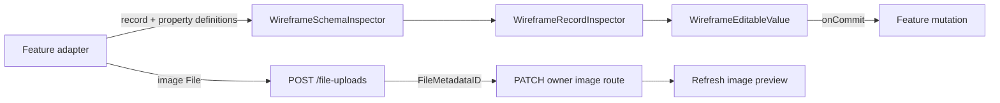

# GemsForge Component API Conventions

This document defines how React components expose structure and behavior in the Gem Life console.

The standard is based on React's [Thinking in React](https://react.dev/learn/thinking-in-react) and [Rules of React](https://react.dev/reference/rules), adapted to the GemsForge design system and application architecture.

For the authoritative canvas, token, layout, motion, and responsive contracts,
see [DESIGN_SYSTEM.md](DESIGN_SYSTEM.md). This document describes how consumers
compose and extend its shared components.

## Core principle

Feature code provides values and user intent. Components provide structure, styling, accessibility, and repeated behavior.

Prefer:

```tsx
<GemEmptyState icon="✦" title="No education records" description="The Education table did not return any records." />
```

over rebuilding the same empty-state markup in every feature.

## Public UI library entry point

Use `@gemsforge/ui` as the supported import surface for shared components and
design values. This keeps feature code independent of the current file layout:

```tsx
import { GemButton, GemStatusPill, GemPageTitle } from "@gemsforge/ui";
```

The public surface may depend on React, Tamagui, and browser presentation APIs.
It must not depend on feature modules, API transport, TanStack Query, Hub data,
or application-specific record models. Keep workflow and domain adapters in
their owning feature folders. `src/styles.css` remains Console-owned and is
loaded once by `main.tsx`; the private package currently relies on some of its
compatibility selectors and is not ready for an independent consumer.

Legacy table/list/card renderers are compatibility-only and live in
`src/components/ui/legacy.ts`; do not add them to the supported public barrel.

## Component layers

### Design-system primitives

These components own reusable visual and semantic building blocks:

- `GemButton`
- `GemField`
- `GemFieldDisplayValue` — theme-aware read-mode value button with visible keyboard focus.
- `GemCard`
- `GemStatusPill`
- `GemLoadingState`
- `GemEmptyState`
- `GemSectionHeader`

`GemButton`, `GemCard`, and `GemStatusPill` consume semantic action, surface,
border, and status roles. Use the button's `tone`, the card's `interactive`, and
the status pill's `tone` props to express intent; avoid setting palette colors
or shadows in feature wrappers.

### Styled components are components

Tamagui's `styled` function returns a React component. It does not need to be
wrapped in a separate function that returns JSX. This is the preferred pattern
for shared visual roles such as typography because the semantic element and its
design tokens stay together:

```tsx
import { SizableText, styled } from "tamagui";

export const GemSectionHeading = styled(SizableText, {
  render: "h2",
  fontSize: "$5",
  lineHeight: "$5",
  fontWeight: "700",
});
```

Consumers render it exactly like any other React component:

```tsx
<GemSectionHeading>Record properties</GemSectionHeading>
```

The function form is also valid, but is more useful when the component needs
behavior or conditional rendering:

```tsx
export function GemSectionHeading({ children }: { children: React.ReactNode }) {
  return <SizableText render="h2">{children}</SizableText>;
}
```

Use the shared GemsForge typography components (`GemPageTitle`,
`GemSectionHeading`, `GemRecordTitle`, `GemBody`, and `GemCaption`) before
creating a new heading style. They centralize font size, line height, weight,
and letter spacing while still accepting normal Tamagui props such as `color`.

Shared field controls such as `GDateField`, `GSelectField`, `GCheckboxField`,
`GSwitch`, and `GSearchField` own their label association, interaction
semantics, and field-level error presentation. Prefer them over feature-local
input markup.

### Workspace and table-kit components

The schema-driven workspace is the standard composition for table-backed
features. `WorkspaceView` owns the shell, while `WireframeLeftPane`,
`WireframeCollectionView`, and `WireframeRecordInspector` provide the shared
navigation, collection, and semantic property surfaces. The `src/table-kit`
modules provide table configuration, record contracts, property renderers,
selection, imports, and query/cache adapters.

Feature components provide schema metadata, typed records, query wiring, and
mutation intent. They should not copy the workspace shell, collection, or
inspector layout. A bespoke feature view is appropriate only when the shared
workspace cannot express the required behavior; document that exception.

#### Inspector interaction components

`WireframeSchemaInspector` adapts typed record property definitions to the
shared `WireframeRecordInspector`. The inspector owns semantic property rows;
`WireframeEditableValue` owns inline editing and save feedback; feature
adapters provide values, editor kinds, options, and save handlers.

| Component                  | Consumer provides                                                                        | Component behavior                                                                                                                                                                                                            |
| -------------------------- | ---------------------------------------------------------------------------------------- | ----------------------------------------------------------------------------------------------------------------------------------------------------------------------------------------------------------------------------- |
| `WireframeSchemaInspector` | A record and its property definitions                                                    | Formats values, derives property metadata, and connects editable properties to save handlers.                                                                                                                                 |
| `WireframeRecordInspector` | `WireframeInspectorField[]`                                                              | Renders labeled property rows and composes property editors.                                                                                                                                                                  |
| `WireframeEditableValue`   | `value`, `label`, `kind`, optional `options`, `nullable`, `displayValue`, and `onCommit` | Ordinary values enter editing on click; select/status values commit through their control; save failures remain visible.                                                                                                      |
| `WireframeImagePreview`    | Optional `src`, `alt`, optional `className`, optional async `onEdit(file)`               | Clicking an image opens the larger preview. With `onEdit`, a separate Edit button chooses an image and reports progress or failure. Without `src`, it shows an empty state while allowing image selection if `onEdit` exists. |

URL and email values preserve their primary link action. URLs open in a new
tab; email addresses use `mailto:`. Editing uses a separate, labeled pencil
button so clicking the value does not replace navigation with text input. The
button is keyboard reachable, appears on hover/focus, and remains visible on
touch layouts. Image previews follow the same action rule: the image opens the
lightbox, and the adjacent button starts replacement.

Image-edit callbacks receive a browser `File`. The feature owns upload and
record association: upload through the shared API client, save the returned
`FileMetadataID` through the record API contract, then refresh the preview.
The preview component does not construct API URLs or decide record ownership.
For Gem Hues, the association endpoint is `PATCH /gemhues/:id/image`; image
bytes continue to load through the authenticated image route.

Table View and per-record presentation state are server state. Use the hooks in
`src/data/presentationQueries.ts`; do not mirror persisted state in browser
storage. See [Table Views](../docs/Table-Views.md) for persistence semantics.

Example: define an editable property in a feature adapter, then pass the
definitions to the shared inspector. The adapter owns the mutation:

```tsx
import type { RecordPropertyDefinition } from "../../table-kit";
import { WireframeSchemaInspector } from "../workspace/WireframeSchemaInspector";

type SampleRecord = { id: string; colorName: string; website: string | null };
type SaveRecord = (id: string, patch: Partial<SampleRecord>) => Promise<void>;

function RecordInspector({ record, saveRecord }: { record: SampleRecord; saveRecord: SaveRecord }) {
  const properties: RecordPropertyDefinition<SampleRecord>[] = [
    {
      id: "colorName",
      label: "Color name",
      kind: "text",
      getValue: (record) => ({ raw: record.colorName, display: record.colorName }),
      edit: {
        onSave: async (source, value) => {
          const selectedRecord = source as SampleRecord;
          await saveRecord(selectedRecord.id, { colorName: String(value ?? "") });
        },
      },
    },
    {
      id: "website",
      label: "Website",
      kind: "url",
      getValue: (record) => ({ raw: record.website, display: record.website ?? "" }),
      edit: {
        inputType: "text",
        nullable: true,
        onSave: async (source, value) => {
          const selectedRecord = source as SampleRecord;
          await saveRecord(selectedRecord.id, { website: value ? String(value) : null });
        },
      },
    },
  ];

  return <WireframeSchemaInspector record={record} properties={properties} />;
}
```

In a real feature, implement `saveRecord` with that feature's TanStack Query
mutation (for example, call `mutateAsync` and return `Promise<void>` after
success).

The URL remains clickable in display mode. Its pencil opens the inline field;
`onSave` is still the feature's responsibility.

Example: attach an image picker without taking the preview's enlarge behavior
away. The upload and association happen in the feature callback:

```tsx
<WireframeImagePreview
  src={imageURL}
  alt={`${hue.colorName} reference`}
  onEdit={async (file) => {
    const metadata = await api.uploadImage(file, "image");
    await api.patchGemHueImage(hue.id, metadata.id);
    setImageRevision((revision) => revision + 1);
  }}
/>
```

Omit `src` to show the empty image state; keep `onEdit` to allow adding the
first image. Omit `onEdit` when the image is intentionally read-only.



### Shared application components

These components compose primitives into recurring application patterns:

- `GemPageHeader`
- `GemRecordList`
- `GemRecordCard`
- `GemDetailPanel`
- `GemFieldGroup`
- `GemErrorState`
- `GemAttachmentSection`

`GemDataTable`, `GemRecordList`, and `GemRecordCard` may remain as compatibility
components during migration. New table-backed screens should use the shared
workspace and table-kit contracts rather than introducing another table layout.

### Feature components

These components own domain-specific behavior and data coordination:

- `EducationView`
- `EmploymentView`
- `TransactionsView`
- `SchemaBuilderView`
- `AttachmentControl`

Feature components should compose shared components rather than rebuild their markup and styling.

## API design rules

### Props describe meaning

Props should describe what a component represents, not how it is implemented.

Prefer:

```tsx
<GemButton tone="primary">Save changes</GemButton>
```

over exposing implementation-specific class names or layout values.

Use semantic names such as:

- `tone`
- `status`
- `selected`
- `busy`
- `open`
- `onSelect`
- `onSubmit`
- `onRetry`

### Props are typed and constrained

Use interfaces for reusable component props and union types for finite variants:

```tsx
interface GemStatusPillProps {
  tone: "success" | "warning" | "danger" | "default";
  children: ReactNode;
}
```

Avoid `any`, arbitrary configuration objects, and unconstrained string variants when the valid values are known.

### Components own repeated semantics

A shared component should own the complete pattern it represents, including:

- Markup structure
- Layout
- Styling
- Accessibility semantics
- Visual states
- Responsive behavior

Consumers should provide values and intent rather than reconstructing the pattern.

### Styling remains intentional

Consumers may provide styling overrides only when the component explicitly supports them. Do not require feature views to know internal class names or layout mechanics.

Use existing Gem Life design tokens before introducing new visual constants. Add a new prop or variant when a recurring semantic distinction exists; do not add props for one-off visual exceptions.

## Feature-view responsibilities

Feature views may:

- Read query results
- Select records
- Pass values into shared components
- Handle feature-specific events
- Coordinate feature-specific hooks
- Choose which component to render

Feature views should not:

- Rebuild shared loading, empty, or error layouts
- Duplicate common field structures
- Duplicate accessibility behavior
- Own generic visual styling
- Mix unrelated workflows into one component

## When to extract a component

Extract a component when:

- The same markup appears more than once.
- The same visual pattern appears in multiple features.
- The same accessibility behavior is repeated.
- Dense markup obscures the feature's intent.
- A typed API makes usage clearer.
- The pattern has an established design-system role.

Do not create a component merely to rename a single `div` or hide markup without adding structure, semantics, behavior, or meaningful reuse.

## State and data ownership

- Server data belongs in TanStack Query.
- Temporary input belongs in component state.
- Related workflows belong in custom hooks.
- Multi-step transitions belong in `useReducer`.
- Derived values should be calculated rather than stored as duplicate state.
- Effects should synchronize with external systems; they should not replace ordinary calculations or event handlers.

See React's [Choosing the State Structure](https://react.dev/learn/choosing-the-state-structure), [Sharing State Between Components](https://react.dev/learn/sharing-state-between-components), and [You Might Not Need an Effect](https://react.dev/learn/you-might-not-need-an-effect).

## Review checklist

Before accepting a component implementation, ask:

- Does the component have one understandable responsibility?
- Does its API expose semantic, typed props?
- Does it own the structure and accessibility of the pattern it represents?
- Is repeated markup represented by a shared component?
- Are loading, empty, error, and success states consistent?
- Is state located at the correct owner?
- Does the consumer provide values and intent instead of implementation details?
- Does the abstraction solve a recurring problem?
- Does the implementation use existing Gem Life tokens and primitives?

## Relationship to the coding policy

This document is the implementation-focused companion to `React-TypeScript-Coding-Policy.md`. The coding policy defines the broader engineering standard; this document defines how that standard applies to component APIs and UI structure.
