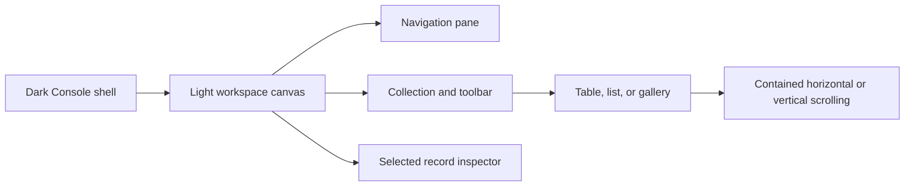

# Gem Life Console design system

This document is the working contract for the Console's visual foundations.
Tamagui configuration is authoritative for React components. `src/styles.css`
bridges those values to older semantic HTML, the native host, and third-party
table renderers while those surfaces migrate.

## Design principles

- **One system, two canvas roles.** The persistent Console shell uses the dark
  application palette. The schema-driven workspace uses a light reading canvas
  for its collection, navigation pane, and inspector. This is intentional, not
  a user-selectable theme mode.
- **Preserve the current composition.** The design system standardizes values,
  layout contracts, and component behavior; it does not redesign existing page
  hierarchies.
- **Use shared values before adding CSS.** Use Tamagui tokens and shared
  components for new or migrated UI. Keep CSS for layout algorithms, browser
  compatibility, third-party integrations, and unmigrated legacy features.
- **Keep behavior with the owning layer.** Shared components own semantics and
  presentation; feature adapters own domain meaning and mutation intent;
  TanStack Query owns API state.

## Canvas and semantic color roles

| Role                   | Dark Console     | Light workspace        |
| ---------------------- | ---------------- | ---------------------- |
| Canvas                 | `$gemCanvas`     | `$wireframeCanvas`     |
| Surface                | `$gemPanel`      | `$wireframePanel`      |
| Raised surface / hover | `$gemPanelLight` | `$wireframePanelLight` |
| Primary text           | `$gemInk`        | `$wireframeInk`        |
| Headings               | `$gemInk`        | `$wireframeHeading`    |
| Supporting text        | `$gemMuted`      | `$wireframeMuted`      |
| Action / focus         | `$gemMint`       | `$wireframeMint`       |
| Reference accent       | `$gemGold`       | `$wireframeGold`       |
| Error                  | `$gemDanger`     | `$gemDanger`           |
| Border                 | `$gemPanelLight` | `$wireframeLine`       |

Use a semantic role rather than selecting a palette color by appearance. Status
colors must retain their text/icon cue; color alone does not communicate state.

## Typography

`gemFontFamily` prefers Avenir Next when installed, then Avenir, Inter, and the
platform UI fonts. No font is downloaded at runtime. The configured size scale
is 12/13/14/16/22/30px with 16/18/20/24/28/38px line heights. The default
body size is 14px. Use the shared
roles from `packages/ui/src/components/ui/GemTypography.tsx` for page, section, record, body,
and caption text. Section headings use 22px through tablet widths and step up to
30px at the desktop breakpoint.

```tsx
import { GemBody, GemPageTitle, GemSectionHeading } from "@gemsforge/ui";

<GemPageTitle>Education</GemPageTitle>
<GemBody>Review and update your education records.</GemBody>
<GemSectionHeading>Record properties</GemSectionHeading>
```

Inspector labels, displayed values, and editable field values use the shared
caption role. Set `valueTextRole="caption"` on a primitive field so the same
token applies in read and edit states, including select options:

```tsx
import { GemCaption, GemPrimitiveField } from "@gemsforge/ui";

<dt><GemCaption fontWeight="700">Institution</GemCaption></dt>
<dd>
  <GemPrimitiveField
    primitive="text"
    label="Institution"
    value="Heron Creek Middle School"
    editing={false}
    valueTextRole="caption"
  />
</dd>
```

Table Kit List rows use that same caption role for property values in both
read-only and inline-edit modes; status values retain their pill treatment at
the caption size. Record titles keep their separate title role; avoid broad
descendant font rules that override these semantic roles.

Keep inspector sizing in these semantic components. The inspector layout may set
color and wrapping, but should not assign separate font sizes to labels and values.
Use `density="compact"` for inspector and inline pagination controls: it sets a
36px desktop minimum height, removes field margins, and retains a 44px minimum
height on touch devices. Shared buttons default to the compact `sm` size; icon
controls retain their dedicated 44px target where needed.

Keep heading levels in document order. A visual size does not justify skipping
the semantic heading level.

## Spacing, sizing, and shape

| Token family                                               | Values                   | Intended use                                      |
| ---------------------------------------------------------- | ------------------------ | ------------------------------------------------- |
| `gemCompact`, `gemControl`, `gemSection`, `gemPage`        | 8, 12, 24, 32px          | Common gaps and padding                           |
| `wireframePane`, `wireframeContent`, `wireframeCard`       | 16, 28, 12px             | Existing workspace pane, content, and card rhythm |
| `gemControl`, `gemCard` radii                              | 8, 16px                  | Shared controls and cards                         |
| `wireframeControl`, `wireframeCard`, `wireframePill` radii | 8, 12, pill              | Workspace controls, cards, and status pills       |
| `fieldControl`, `gemTouchTarget`                           | 44px                     | Standard field and touch target height            |
| Shared button minimum                                      | 36px desktop; 44px touch | Compact action controls with touch-sized targets  |
| `gemBorderHairline`, `gemBorderEmphasis`                   | 1, 2px                   | Separators and emphasized outlines                |
| `gemElevation.card`, `gemElevation.floating`               | shared shadows           | Raised cards and floating surfaces                |

Use semantic theme roles (`action`, `actionText`, `focus`, `success`,
`warning`, and `danger`) in shared components. CSS compatibility styles map the
same status roles onto legacy markup and the light workspace canvas.

Prefer the nearest existing role. Do not add a token for a one-off measurement
unless that value defines a reusable layout or component contract.

## Layout recipes

### Application shell

- Persistent navigation and route content stay in the shared shell.
- At desktop widths, the navigation pane starts at 18rem, can resize up to
  22.5rem, and leaves at least 26.25rem for route content. The compact rail is
  4.25rem wide; the label threshold is a shared layout value.
- At 900px and below, navigation collapses to the compact icon rail; content
  remains the primary scroll region.
- At 640px and below, multi-column form and feature grids become one column.

### Table workspace



- Preserve the three-region composition: navigation, collection, and
  inspector. The wireframe MVP uses a 15rem navigation pane and a 22.5rem
  inspector; the inspector remains resizable on desktop.
- Keep collection content and inspector independently shrinkable with
  `minWidth: 0`; wide tables scroll inside the collection rather than widening
  the page.
- Keep record cards at their defined aspect ratio and size. Grid columns adapt
  to available space; card content scrolls or truncates within its region.
- At 1100px and below, navigation opens in a drawer and the inspector overlays
  the collection. At 640px and below, the inspector becomes a bottom sheet,
  list properties stack below each title, view modes move into a touch-sized
  dropdown, and the remaining collection actions keep room in the toolbar.
- The selected record uses the same quiet mint surface in list, table, and
  gallery views. Property labels and values share a compact readable size.

### Forms, dialogs, and feedback

- Forms use shared field components, visible labels, field-level validation,
  and a shared submit action. A field's label and error remain adjacent to it.
- Dialogs stay within the viewport (`100dvh` minus page clearance) and own
  their internal scrolling when their content exceeds that height.
- Loading, empty, error, and success states use shared semantic components or
  status roles. Announce asynchronous feedback and preserve keyboard focus.

## Component contract

Use shared components from `@gemsforge/ui` and `components/forms` for common
actions, fields, cards, headings, status, loading, and empty states. Components
expose intent (`tone`, `size`, `status`, `label`) rather than CSS mechanics.

| State           | Contract                                                                  |
| --------------- | ------------------------------------------------------------------------- |
| Rest            | Semantic role and readable foreground/surface pairing                     |
| Hover / pressed | Shared action or raised-surface role; never a layout shift                |
| Focus           | Visible focus indicator with offset; keyboard order follows reading order |
| Disabled        | Native disabled semantics plus a visible disabled treatment               |
| Loading         | Preserve the control's label; expose busy state and progress              |
| Error / success | Pair icon or text with color; announce dynamic feedback                   |

```tsx
<GemButton tone="primary" disabled={isSaving} aria-busy={isSaving}>
  {isSaving ? "Saving…" : "Save changes"}
</GemButton>
```

Check [COMPONENT_API.md](COMPONENT_API.md) for props, editing behavior, and
feature adapter examples.

## UI workspace package boundary

`@gemsforge/ui` is the stable public entry point for reusable UI. Its source
lives in `packages/ui` and exports maintained components, design values, and
the Tamagui configuration. New feature code should import shared pieces through
this entry point:

```tsx
import { GemButton, GemCard, GemSectionHeading, gemSpacing } from "@gemsforge/ui";
```

The library owns reusable presentation, accessibility semantics, component
props, and design values. Feature folders own domain-specific views, API calls,
query hooks, record models, and save behavior. The Console imports
`src/styles.css` once. It contains application layout, workspace rules, and
compatibility CSS used by some shared controls, so the private package currently
serves the Console only. Extracting a stylesheet contract is required before a
second app can use it independently.

Retired table, list, and record-card renderers remain under
`src/components/ui/legacy.ts`. They depend on Console presentation helpers and
are excluded from the package entry point.

```mermaid
flowchart LR
  Feature[Feature views] --> PublicUI[@gemsforge/ui workspace package]
  PublicUI --> Components[Shared React components]
  PublicUI --> Tokens[Design tokens and Tamagui config]
  App[Console app entry] --> Styles[styles.css compatibility and app layout]
```

This is a private npm workspace package with source exports; it is not published
to a registry. Before adding another React consumer, extract the required
stylesheet rules, add distributable JavaScript and declaration outputs, and
verify both consumers. Keep native SwiftUI integration on shared generated
design values rather than attempting to consume React components.

## Responsive breakpoints, layering, and motion

| Name    |            Width | Use                                                                     |
| ------- | ---------------: | ----------------------------------------------------------------------- |
| Compact |  640px and below | Single-column forms; narrow controls wrap or scroll within their region |
| Tablet  |  900px and below | Collapsed application navigation and reduced pane density               |
| Desktop | 1200px and above | Full application layout and multi-column feature grids                  |

The Tamagui media keys are `compact`, `tablet`, and `desktop`. Existing CSS
rules at 760px and 1100px are documented compatibility breakpoints for older
feature layouts; new shared components must use the named keys. Layer values
are `gemContent < gemSticky < gemFloating < gemDialog < gemNotification`.
Motion roles are 120ms quick, 180ms standard, and 240ms emphasized. Respect
`prefers-reduced-motion`; do not animate layout or essential information.

At compact widths, collection headers wrap their description and record count,
and collection actions use aligned rows with 44px targets. List rows put the
record title first and stack visible properties beneath it so long values can
wrap across the available width. Tables keep horizontal scrolling inside the
table region rather than widening the page.

## CSS compatibility boundary

The root custom properties in `src/styles.css` mirror the Tamagui palette and
shared elevation roles for legacy CSS consumers. The `.wireframe-demo` and `.wireframe-collection-page`
scopes intentionally remap those aliases to the light workspace palette. Other
feature rules remain CSS-owned until their feature migration; table-library
variables and geometry rules also stay in CSS because the grid and virtualized
renderers consume CSS custom properties directly. The wireframe MVP's shared
responsive layout and collection presentation live in
`src/design-system/wireframe-mvp.css`, imported after the compatibility sheet.

When migrating a surface:

1. Use an existing shared component or Tamagui primitive.
2. Use the token for each visual role and breakpoint.
3. Remove the obsolete selector only after every consumer uses the shared
   contract.
4. Keep geometry CSS only where the browser or third-party renderer needs it,
   and document that boundary here.

The current source/consumer relationship is tracked in
[#505](https://github.com/GemsForge/GemsForgeAPI/issues/505). Feature-specific
pages migrate incrementally after the shared shell and workspace foundation.
