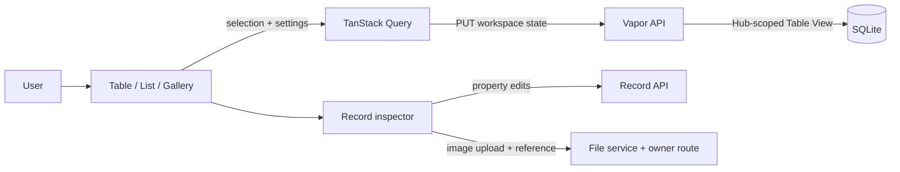

# Gem Life React testing console

This is the React + TypeScript replacement for the original local browser
prototype. It is a developer testing interface for the private Vapor API, not
the finished Gem Life product UI. Its M3 foundations now include routing,
server-state hooks, a design system, native capabilities, local sessions,
production asset packaging, accessibility and responsive/performance checks.

Start with [UI standards](UI_STANDARDS.md) for implementation conventions and
[the design system](DESIGN_SYSTEM.md) for canvas, tokens, layout, and component
roles. Protected Console routes require the local API session described in
[Local authentication](../docs/Local-Authentication.md).
This does not make the API public; see the deployment security gate before
changing its private deployment posture. Live database attachment-column
mismatches are tracked separately in [#178](https://github.com/GemsForge/GemsForgeAPI/issues/178).

## Start the API

From the repository root:

```bash
DATABASE_PATH="/absolute/path/to/GemLife_DB_rebuild.sqlite" \
swift run GemsForgeAPI serve --hostname 127.0.0.1 --port 8081
```

## Start the React console

In a second terminal:

```bash
cd Console
VITE_API_TARGET="http://127.0.0.1:8081" \
npm run dev
```

Configure the API's `LOCAL_AUTH_USERNAME`, `LOCAL_AUTH_PASSWORD`, and
`GEM_LIFE_OPERATOR_ACCOUNT_ID` as described in the authentication guide.

Open `http://127.0.0.1:4173/`.

Vite proxies API paths to Vapor so the browser can use same-origin requests:

```text
/domains
/forgekeeper
/gemhues
/education
/employment
/addresses
/transactions
/file-metadata
/file-uploads
/health
/auth
/service-accounts
/expense-categories
/expense-subcategories
/table-views
/record-presentations
/schema-builder
/live-database
```

## Structure

```text
packages/ui/                       private @gemsforge/ui workspace package
src/
├── api.ts                         typed API client
├── types.ts                       API response and request types
├── components/                    Console composition and legacy adapters
└── features/                      domain views and workspace features
```

The schema-driven workspace composes the Table Kit collection and the record
inspector. Table, List, and Gallery views share the same record selection and
schema-backed properties. The API persists each view's workspace state and
per-record presentation state within the authenticated Hub; TanStack Query
loads and updates that server state. See [Table Views](../docs/Table-Views.md)
for the saved-state contract.



## Record collections

Record-list screens share `RecordCollection`, `RecordUtilities`,
`useRecordUtilities`, and `usePagedRecords`. This keeps query state local to
the active collection while applying search, sort, filters, result summaries,
and pagination in a consistent order.

When extending a record view:

1. Pass the complete record set to `useRecordUtilities`.
2. Include the ID and relevant display fields in its searchable values.
3. Add stable comparators for supported text, date, and numeric sort fields.
4. Provide readable categorical values through `filterOptions`.
5. Pass the filtered records to `usePagedRecords` and show the total and
   matching counts in `RecordUtilities`.

Use the built-in clear action to reset search, sort, and filter state together.
Keep create/edit forms, loading and error feedback, empty states, and list
content within the collection's boundary so query changes do not alter form
submission behavior.

## Design system

Tamagui is configured in `packages/ui/src/design-system/tamagui.config.ts`. The existing
Gem Life palette is registered as shared color tokens so reusable components
can consume the same visual language without copying literal color values.
The provider is mounted at the application entry point; feature components
will migrate to Tamagui primitives in focused follow-up issues.

The private shared UI workspace package lives in `packages/ui` and is imported
through `@gemsforge/ui`. It exports maintained components and design-system
values. Feature views should compose these primitives instead of repeating
buttons, cards, and labelled fields. Feature logic, API/query behavior, and
global compatibility CSS remain owned by the Console. See
[Component API](COMPONENT_API.md) for the public boundary and the
[package README](packages/ui/README.md) for current limits before another app
can consume it independently.

Server data uses TanStack Query through `src/data`. Query keys and caching
policies belong there; feature components should consume query hooks instead
of issuing raw requests during rendering.

### Workspace and inspector

`WorkspaceView` owns the workspace shell. Feature adapters provide records,
property definitions, and save handlers; `WireframeCollectionView` and
`DatabaseRecordCollection` coordinate the available presentations, collection
utilities, selected record, and inspector. Saved workspace state includes the
active view, selected record, search, sort and direction, filter, grouping,
pagination, and supported gallery/property display settings. It is loaded before
local changes are saved and stored on the matching Hub-scoped Table View.

`WireframeSchemaInspector` maps schema property definitions into
`WireframeRecordInspector`. Ordinary editable values enter edit mode on click.
URLs and email addresses retain their link action and expose a separate Edit
button; image previews retain their enlarge action and expose a separate image
picker. Image updates upload through `/file-uploads`, then save the returned
file metadata reference through the owning API route. See
[`COMPONENT_API.md`](COMPONENT_API.md) for the component contracts.

### Create-form standard

Use React Hook Form for form state and submission, Zod for runtime validation
and inferred values, and `@hookform/resolvers` (`zodResolver`) to connect them.
Use TanStack Query mutations for API writes, loading state, error handling, and
cache invalidation. Compose the shared create form field, error, submit, and
attachment controls; keep each resource's schema, editable properties,
relationship selectors, and create/PATCH payload mappings explicit in its
feature. Create payload types must be separate from response types and must
follow [`Record-Creation-Contracts.md`](../docs/Record-Creation-Contracts.md).
Upload/attach files after creation when the server needs the new record ID to
establish attachment ownership. Client validation is for feedback only; the
Swift API remains authoritative.

Attachments use the shared `FilePresentation` component for metadata, full-image
previews, loading, missing-file, invalid-image, and retry states. Image bytes are
read through the API content endpoint, never through local filesystem paths.
The browser picker remains available; `AttachmentControl.selectImage` provides
a File-returning adapter for native selection. The trusted SwiftUI host now
uses its system image picker through that boundary. See
[`Attachment-Lifecycle.md`](../docs/Attachment-Lifecycle.md) for the contract.

## Schema builder

The Developer → Build & Import view is a local testing workflow for creating a
new table in the configured database. Enter an UpperCamelCase table name, add
at least one property, choose its SQLite type, and use **Add property** for
additional columns. The API supplies the required unique `TEXT` `ID` primary
key; the UI never asks the user to define it.

The flow previews the generated definition before execution. Execution requires
the API environment variables `DATABASE_PATH` and
`LIVE_DATABASE_BACKUP_DIRECTORY`, because the API creates a backup before
changing the database. Duplicate table names are reported in the builder and
require choosing a different name.

The console is intentionally a local testing client, not the official Gem Life
product UI. It supports record editing and workspace presentation workflows
where the API exposes them. It is not an authorization boundary or a
replacement for API tests.

## Build

```bash
npm run build
```

Run `npm test` for interaction, query, workflow, contrast and paging checks.
For the local release bundle and launcher, see the
[host packaging guide](../GemLifeHost/README.md#production-packaging).
