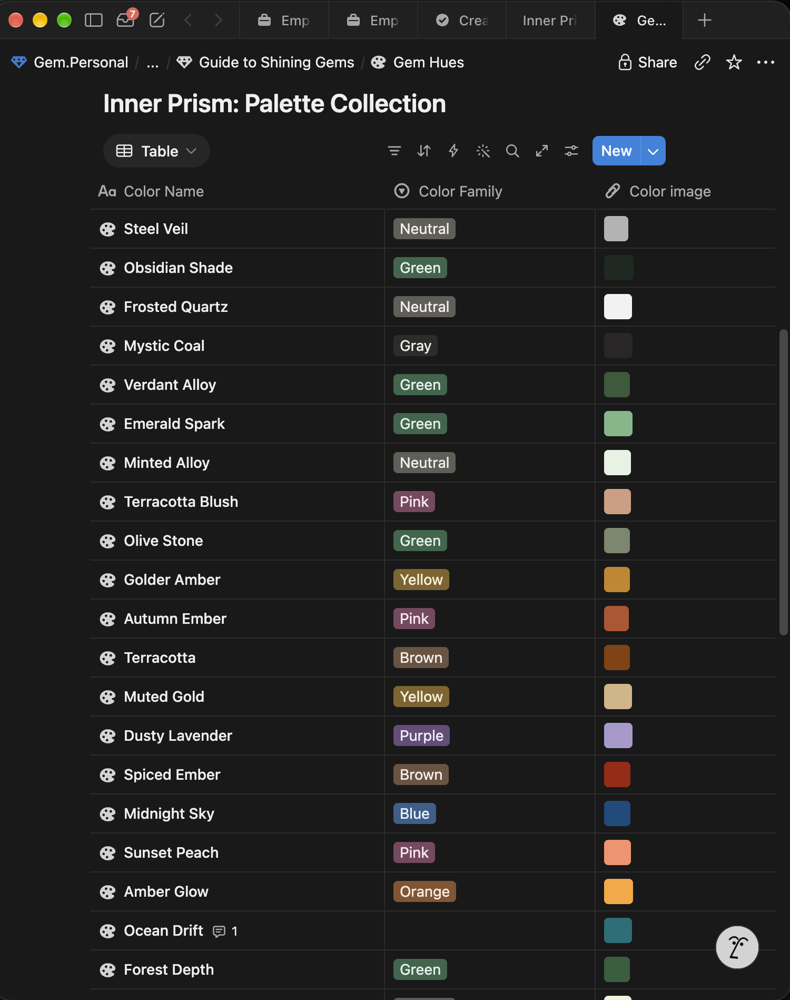

# Issue #369: Responsive tablet / half-width console

## User story

As a user viewing Gem Life in a half-width window or tablet viewport, I want a
single content pane with compact navigation so that controls and records remain
readable and usable without horizontal page scrolling.

## Reference interaction

The screenshot below is the visual reference for a dense, table-oriented view:

The table should remain readable at tablet widths, while its actions and
columns adapt to the available space. If the table cannot fit, scrolling should
remain contained within the table region rather than moving the whole page.

## Acceptance criteria

- Collapse the left navigation to an icon rail below 900px while retaining
  accessible names for every destination.
- Allow the navigation divider to be resized with pointer drag, arrow keys,
  Home, End, and double-click.
- Reveal navigation labels once the pane reaches 160px and use compact padding
  so labels do not remain hidden behind an unnecessarily wide empty pane.
- Clamp the navigation pane between 68px and 360px while reserving at least
  420px for the main content pane.
- Re-clamp a manually resized pane when the browser width changes.
- Keep navigation, divider, and content in one horizontal workspace row; they
  must not overlap or stack while resizing.
- Let page headers, actions, filters, and content panels reflow within the main
  pane as space narrows.
- Reduce record-card columns as the viewport narrows.
- Keep wide tables horizontally scrollable inside their own named region.
- Prevent long names, IDs, forms, and images from overflowing the viewport.
- Preserve accessible focus states and keyboard navigation.
- Support compact, tablet, and desktop layouts consistently.
