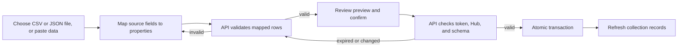

# Schema-backed data import

Schema-backed Wireframe collections reuse the existing **Import File** and
**Paste data** choices. Both accept CSV or JSON arrays of scalar row values.
The Console maps source fields to the selected table, then asks the API to
validate the mapped data before it can be committed. The API owns table
eligibility, schema validation, Hub assignment, primary-key generation, and
database writes; the Console never sends SQL.

## Workflow



## Table and ownership contract

The API accepts eligible Hub-owned tables with a stable primary key and text
`HubID`. It assigns `HubID` from the authenticated session and generates text
primary keys. Integer primary keys are left to SQLite. Neither server-managed
field can be mapped from an import. Feature-owned or protected tables remain
behind their dedicated routes.

New tables created through Schema Builder automatically receive:

- `ID`: required text primary key, generated by the server.
- `HubID`: required text ownership field, assigned by the server.
- `Title`: required text item name.

Alex supplies the table name and may add other properties. Existing tables
without a literal `Title` column are not changed; their Wireframe pages keep
using an existing display property.

For example, a `ReadingGoals` table can add `Goal` and `TargetDate`; the server
adds the three required columns above:

```json
{
  "tableName": "ReadingGoals",
  "columns": [
    {
      "name": "Goal",
      "dataType": "TEXT",
      "nullable": false,
      "defaultValue": null,
      "primaryKey": false,
      "unique": false
    },
    {
      "name": "TargetDate",
      "dataType": "TEXT",
      "nullable": true,
      "defaultValue": null,
      "primaryKey": false,
      "unique": false
    }
  ]
}
```

## Input and validation

- Choose a `.csv` or `.json` file (maximum 1 MB), or paste CSV/JSON content.
- CSV uses a header row. JSON is an array of objects with scalar values.
- The Console suggests case-insensitive matches and lets Alex map each source
  field to one distinct table property. Unmapped fields are skipped.
- The API reports missing required properties, numeric/boolean type errors,
  malformed CSV rows, and row numbers before any write.
- Up to 500 records are accepted per preview. A preview with any invalid row
  cannot be committed.
- Preview tokens expire after five minutes, are single-use, and are bound to
  the authenticated Hub, table schema, field mapping, and validated values.
- A uniqueness or database constraint failure rolls back the full batch.

CSV example:

```csv
Title,Quantity,Description
"Dining table",2,"Oak, extendable"
Desk,1,"He said ""hello"""
```

JSON example:

```json
[
  { "Title": "Dining table", "Quantity": 2, "Description": "Oak, extendable" },
  { "Title": "Desk", "Quantity": 1, "Description": "Writing desk" }
]
```

The Console converts JSON scalar rows into the importer's normalized tabular
payload so the same server-side type, required-field, mapping, and transaction
checks apply to both formats. Binary files and attachment bytes use their
dedicated workflows.

## API boundary

| Endpoint                                         | Behavior                                                                  |
| ------------------------------------------------ | ------------------------------------------------------------------------- |
| `GET /table-import/tables`                       | Lists tables eligible for the authenticated Hub.                          |
| `POST /table-import/preview`                     | Validates mapped rows against ownership and the current table schema.     |
| `POST /table-import/commit`                      | Consumes a valid preview token and inserts the complete batch atomically. |
| `POST /schema-builder/tables/:tableName/records` | Creates one schema-backed row and assigns its Hub and ID server-side.     |

Use isolated SQLite databases for automated verification. Do not run import
tests or preview/commit requests against a personal database.
