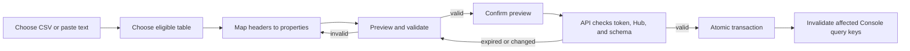

# Table Kit CSV import

The Table Kit's **Import CSV** action imports rows into an existing, server-approved custom table. It does not create or alter a table. The API owns table eligibility, schema validation, Hub assignment, and writes; the Console never sends SQL.

## Workflow



## Eligible tables

The authenticated API lists existing custom SQLite tables with a non-null text `HubID` column. When creating a custom table through the schema builder, add `HubID` as a required text property. The importer supplies the authenticated HubID and never allows CSV mapping to target that property. Feature-owned tables, authentication and schema-management tables, file metadata, and presentation state are excluded because their routes enforce additional invariants.

Tables without a required text `HubID` are not importable. Create or alter tables only through the reviewed schema-management workflow; import does not add ownership columns or change the schema.

For example, the schema builder can define a table like this before its reviewed preview and execution:

```json
{
  "tableName": "ReadingGoals",
  "columns": [
    {
      "name": "HubID",
      "dataType": "TEXT",
      "nullable": false,
      "defaultValue": null,
      "primaryKey": false,
      "unique": false
    },
    {
      "name": "Goal",
      "dataType": "TEXT",
      "nullable": false,
      "defaultValue": null,
      "primaryKey": false,
      "unique": false
    },
    {
      "name": "TargetDate",
      "dataType": "TEXT",
      "nullable": true,
      "defaultValue": null,
      "primaryKey": false,
      "unique": false
    }
  ]
}
```

The schema builder adds the required text `ID` primary key. For this table, include and map an `ID` header (for example, a UUID) along with `Goal` and `TargetDate`. During CSV import, the API supplies `HubID` for the signed-in Hub.

## CSV and mapping rules

- Select a `.csv` file (maximum 1 MB) or paste CSV content.
- CSV parsing supports quoted commas, doubled quote escapes, CRLF, and embedded newlines.
- Headers must be unique and non-empty. Map each selected header to one distinct table property; unmapped headers are ignored.
- The API reports missing required properties, numeric/boolean type errors, malformed rows, and row numbers before any write.
- New custom tables have a required text `ID` primary key; include and map an `ID` header. Database-generated integer primary keys can be omitted.
- Up to 500 data rows are accepted per preview. A preview containing any invalid row cannot be committed.
- File contents and attachment bytes are not imported. Import those through their dedicated flows.

Example:

```csv
Name,Quantity,Description
"Dining table",2,"Oak, extendable"
Desk,1,"He said ""hello"""
```

The Console submits a table name, the original CSV text, and a header-to-column mapping to `POST /table-import/preview`. The API returns normalized row previews and, only when every row is valid, a five-minute one-use token. `POST /table-import/commit` accepts only that token. It is bound server-side to the authenticated Hub, table, schema, mapping, and previewed values. Schema drift or a database constraint error aborts the transaction; no partial batch is retained.

## Console integration example

The shared database collection and wireframe collection attach the same operation to their Table Kit New Record utility:

```tsx
newRecordUtility={{
  options: [
    ...existingCreateOptions,
    createTableCSVImportOption(),
  ],
}}
```

The Console reads importable tables with TanStack Query, posts preview and commit requests through `api.ts`, and invalidates the importable-table, schema, and target-table record query keys after success. Mutation failures remain visible in the open import workflow; the user creates a fresh preview before retrying a failed commit.

## API boundary

| Endpoint                     | Behavior                                                                  |
| ---------------------------- | ------------------------------------------------------------------------- |
| `GET /table-import/tables`   | Lists tables eligible for the authenticated Hub.                          |
| `POST /table-import/preview` | Validates CSV, mapping, ownership, and current schema without writing.    |
| `POST /table-import/commit`  | Consumes a valid preview token and inserts the complete batch atomically. |

Use an isolated SQLite database for automated verification. Do not run import tests or preview/commit requests against the personal database.
